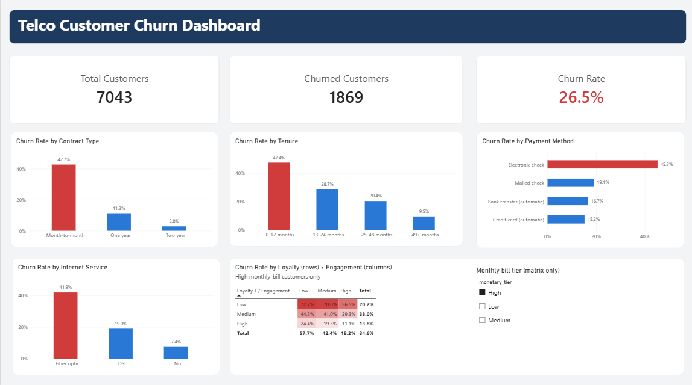
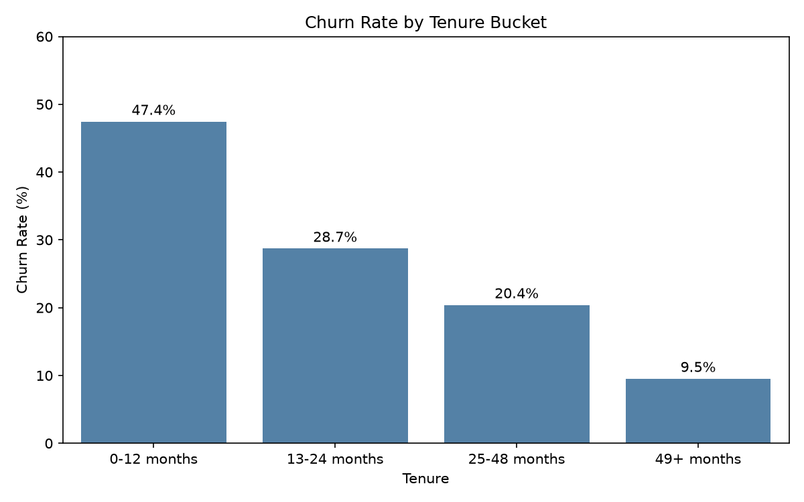
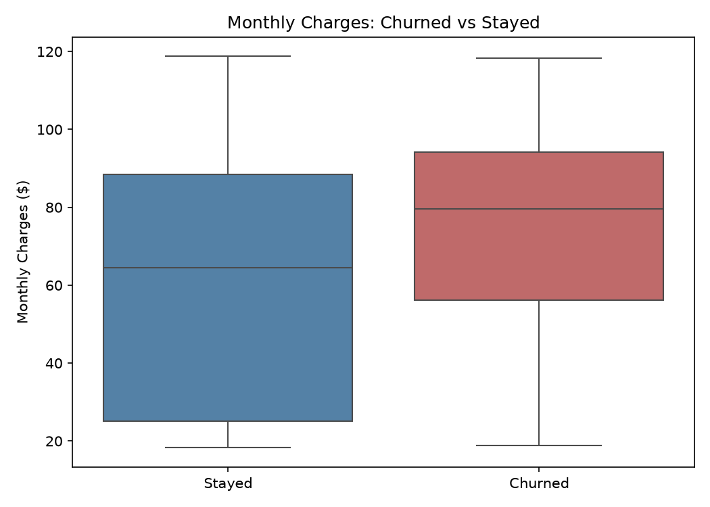

# Customer Churn and Segmentation (Telco)

Which customers are most likely to churn, and how should the business prioritize retention efforts?

This project analyzes 7,043 customers of a fictional telecom company using MySQL, Python and Power BI. It ends with a segmentation of customers by risk and a set of retention recommendations.



## Business questions

1. What percentage of customers churn overall?
2. Which segments churn most (contract, tenure, payment method, services)?
3. Does monthly charge or total spend relate to churn?
4. Can we group customers into RFM-style segments and identify the highest-risk ones?
5. What should the business do to reduce churn?

## Tools

- **MySQL**: data loading, cleaning, churn rates by segment, RFM view
- **Python** (pandas, seaborn, scipy): chi-square tests and charts
- **Power BI**: interactive dashboard

## Dataset

IBM Telco Customer Churn sample (`WA_Fn-UseC_-Telco-Customer-Churn.csv`, from Kaggle): 7,043 customers, 21 columns, one row per customer. It covers tenure, contract, payment method, services subscribed, monthly and total charges, and whether the customer churned.

**Data cleaning:** `TotalCharges` holds blank strings for 11 customers, all with tenure of 0 (new customers not yet billed). I loaded the column as text, then converted it to a number with blanks becoming `NULL`. These 11 rows stay in the churn-rate calculations and are only skipped where total charges are averaged.

## Key findings

**1. Overall churn is 26.5%** (1,869 of 7,043 customers).

**2. Churn is concentrated in a few clear segments.**

| Segment | Churn rate |
|---|---|
| Month-to-month contract | 42.7% |
| One-year contract | 11.3% |
| Two-year contract | 2.8% |
| Tenure 0-12 months | 47.4% |
| Tenure 49+ months | 9.5% |
| Electronic check payers | 45.3% |
| Automatic payment (bank or card) | 15.2% to 16.7% |
| Fiber optic internet | 41.9% |
| DSL internet | 19.0% |
| No internet | 7.4% |

Chi-square tests confirm that contract type (chi-square = 1184.6, df = 2) and payment method (chi-square = 648.1, df = 3) are both significantly associated with churn (p < 0.001).

**3. Monthly price matters. Total spend is misleading.**
Churned customers pay more per month (mean $74.44 vs $61.27). Their total spend is lower ($1,532 vs $2,555), but that is a tenure effect: they leave early, so their total never builds up. Monthly charges is the meaningful signal.

**4. RFM-style segmentation finds the highest-risk group.**
Since the data has no transactions, I adapted RFM to three proxies:

- Loyalty (recency proxy): tenure, split at 12 and 48 months
- Engagement (frequency proxy): number of add-on services (security, backup, device protection, tech support, streaming TV and movies)
- Monetary: monthly charges, split at $35 and $75

| Loyalty | Engagement | Monetary | Customers | Churn rate |
|---|---|---|---|---|
| Low | Low | High | 289 | 72.7% |
| Low | Medium | High | 303 | 70.6% |
| Low | High | High | 62 | 56.5% |
| Low | Low | Medium | 635 | 54.6% |

The safest large segment is High loyalty, Low engagement, Low monetary (445 customers, 1.3% churn).

These four high-risk segments hold **18% of customers but 43% of all churn** (1,289 customers, 806 of the 1,869 churners).




## Recommendations

1. **Focus retention on new customers with high bills.** The Low loyalty, High monetary group (654 customers, about 70% churn) is the top priority. It is small enough to target directly and is where most preventable churn sits.
2. **Build a first-year onboarding program.** Nearly half of customers in their first 12 months churn. Check-ins, setup help and a bill review at months 2 to 3 would reach them before they decide to leave.
3. **Move month-to-month customers onto longer contracts.** Offer a discount or perk for a one-year term. One-year customers churn at about a quarter of the month-to-month rate.
4. **Encourage automatic payment.** Electronic check payers churn about three times as often as customers on automatic payment. A small credit for switching to bank or card autopay is a cheap test.
5. **Bundle support and security with fiber plans.** High-bill customers with no add-ons have the highest churn. Adding tech support or security creates value and switching costs. Also investigate fiber service quality and pricing, since churn is more than double DSL.

## Limitations

- The analysis shows association, not causation. For example, electronic check payers may differ from other customers in ways the data doesn't capture, so recommendation 4 should be validated with an A/B test.
- The RFM tiers use fixed cutoffs chosen from the tenure and charge distributions. Different cutoffs would shift the exact segment sizes, but the high-risk pattern is strong across all three dimensions.
- The dataset is a single snapshot with no dates, so churn timing and trends over time can't be studied.

## Repository structure

```
telco-churn/
├── data/            raw CSV and the RFM export used by Power BI
├── sql/             setup, churn analysis and RFM view scripts
├── notebooks/       churn_analysis.ipynb and chart images
├── powerbi/         dashboard (.pbix) and screenshot
└── README.md
```

## How to reproduce

1. Run the setup script in `sql/` in MySQL, then import the CSV into `customers_raw` (the Workbench Table Data Import Wizard works).
2. Run the remaining scripts in `sql/` to build the `customers` table and the `customer_rfm` view.
3. Open `notebooks/churn_analysis.ipynb`. It asks for your MySQL password when you run it, so no credentials are stored in the file.
4. Open the `.pbix` in `powerbi/`, or load `data/customer_rfm_export.csv` into a new Power BI report.
